  

### 👋 Hey, I'm Alex

- 🖥️ **FSWEP Mainframe Developer** @ Employment and Social Development Canada
- 🎓 Computer Engineering Technology – Computing Science co-op student
- 🔧 Working from batch jobs to browsers: mainframe, Java, C, PHP and the web

### 📌 Projects

| Project | What it is |
| --- | --- |
| [PersonalFinanceTracker](https://github.com/alexanderschnell/PersonalFinanceTracker) | Standalone Java desktop app for tracking personal finances |
| [Audioninja](https://github.com/alexanderschnell/Audioninja) | PHP web app for music producers |
| [Portfolio-Website](https://github.com/alexanderschnell/Portfolio-Website) | My portfolio site: PHP, CSS, JavaScript |
| [GuessTheNumberGame](https://github.com/alexanderschnell/GuessTheNumberGame) | CLI number-guessing game in C |
